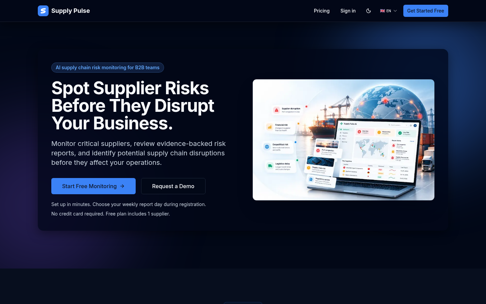
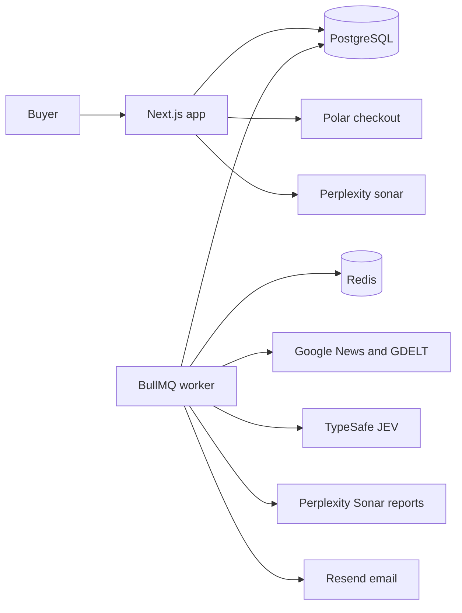
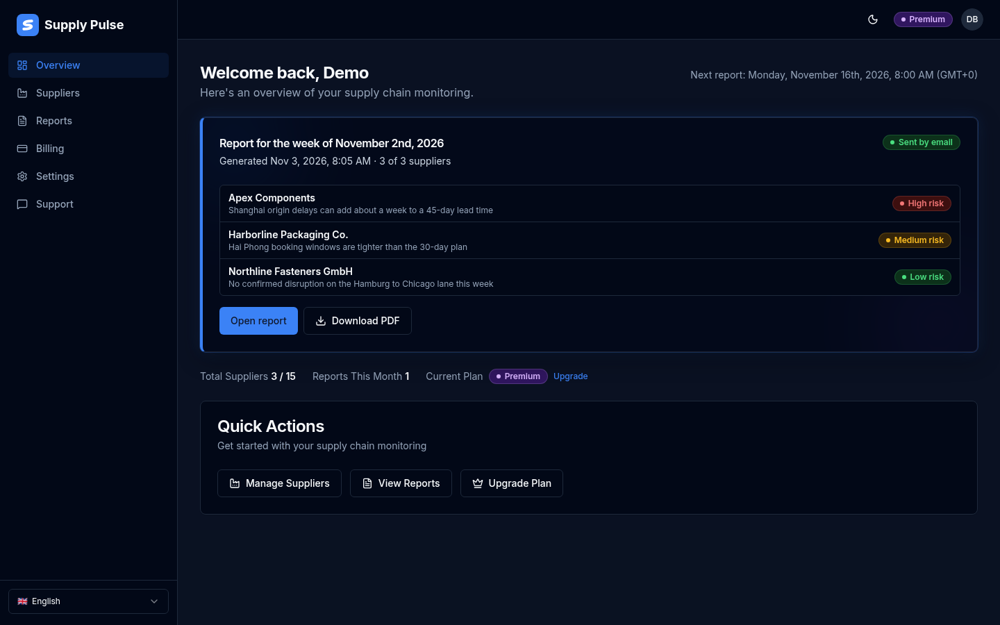
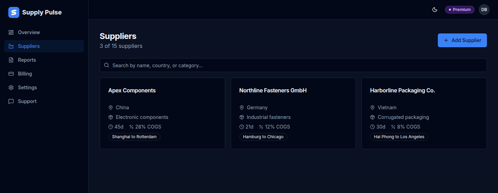
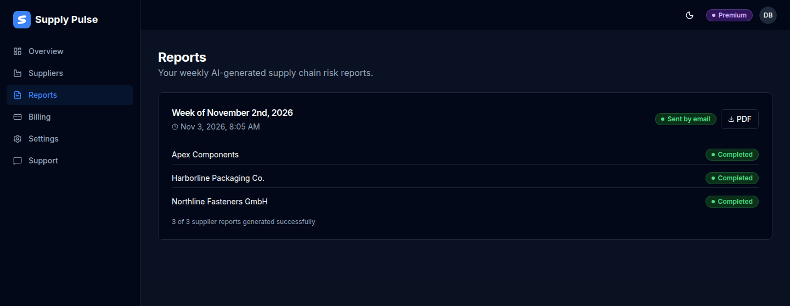
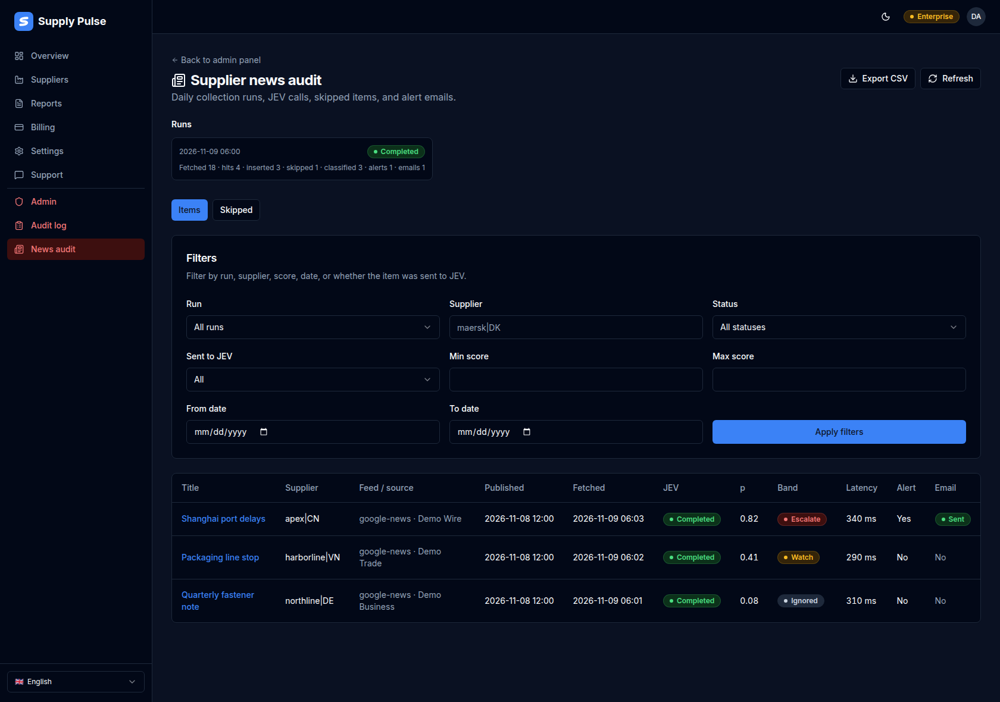

# Supply Pulse

Weekly, cited AI risk reports for the suppliers a business actually depends on — plus interim disruption alerts when public news looks severe.


Supply Pulse is a multi-tenant SaaS for importers, manufacturers, and distributors. A buyer adds supplier profiles. A background worker researches each one on a chosen weekday, emails a PDF, and shows P1 / P2 / P3 priorities on the dashboard.



## The problem

A late shipment is usually old news by the time it shows up in a spreadsheet. Port congestion, strikes, plant shutdowns, sanctions, and export-control changes are published in public sources days earlier, but a small procurement team cannot read all of them for every supplier and lane.

Generic news alerts are noisy. What matters is whether an item can affect *this* supplier’s ability to deliver on time, at the agreed quality and price, given that supplier’s country, category, lead time, and share of cost of goods sold.

## The solution

Supply Pulse keeps a profile for each monitored supplier and turns public information into a structured weekly report:

1. The buyer records the supplier name, country, category, lead time, COGS share, and optional shipping route and dependencies.
2. On the weekday and UTC hour chosen at signup, a worker generates one report per supplier.
3. The report separates confirmed events, watch signals, and hypothetical scenarios, and it cites sources.
4. The buyer gets an email with a PDF. The dashboard ranks suppliers by the top priority in that report.
5. Between weekly reports, a daily news job can email a short alert when a headline scores as a likely disruption.

Plans are Free (1 supplier), Standard ($29.99, 5 suppliers), Plus ($79.99, 5 suppliers, deeper reports and a mid-week alert), Premium ($199.99, 15 suppliers, daily alerts), and Enterprise (custom supplier count, daily alerts). Billing runs through Polar.

## Key features

- **Supplier profiles** with search, edit, and delete. Creating or updating a profile checks that the fields are internally consistent before they are saved.
- **Weekly report runs** on a per-user schedule. A scheduler checks every 15 minutes for users whose `nextReportAt` is due.
- **Consolidated PDF** for the latest run, localized to the user’s language (English, Spanish, Portuguese, French, or German).
- **Dashboard risk view** that reads P1, P2, and P3 rows out of the generated report and labels them high, medium, or low.
- **Daily supplier news** from Google News RSS and GDELT, shared across customers who monitor the same supplier name and country.
- **Interim email alerts** for Plus (once mid-week) and Premium / Enterprise (each day a new severe item is waiting). Free and Standard keep those signals for the weekly report only.
- **Admin news audit** of each daily run: inserted items, skipped headlines, classifier scores, and whether the alert email was sent.
- **Account controls**: credentials login, password reset, terms consent, cookie consent, and an admin audit log of security-relevant actions.
- **Registration CAPTCHA** via Cloudflare Turnstile.

## AI architecture

Three model calls are in the product. None of them run in the browser. API keys stay on the server and on the worker.

| Step | Model | When |
| --- | --- | --- |
| Supplier profile check | Perplexity `sonar` | On create or update, unless `SUPPLIER_VALIDATION_SKIP=true` |
| Weekly report | Perplexity `sonar-pro` (Free, Standard) or `sonar-deep-research` (Plus, Premium, Enterprise) | Scheduled weekly run, and manual runs |
| Disruption score | TypeSafe **JEV** `jev-latest` at `https://api.typesafe.ai/v1/systemone` | Daily news job, after a keyword filter |
| Alert blurb | Perplexity `sonar-deep-research` | Only when a JEV score is high enough to escalate |

**Profile check.** `validateSupplierProfile` asks `sonar` whether the name, country, category, route, and dependencies are logically consistent (for example, a country that does not match the shipping lane). The prompt tells the model not to reject a supplier merely because it cannot find the company online. The response must be JSON (`valid`, `summary`, `issues`). A service failure returns an error; it does not silently save a bad profile.

**Weekly report.** `generateSupplierReport` posts to `https://api.perplexity.ai/chat/completions` with `search_recency_filter: "week"` and citations enabled. The prompt requires seven markdown sections: executive summary with a P1/P2/P3 table, confirmed risks from the past 7 days, watch signals, 30-day scenarios, supply alternatives, recommendations, and optional supporting detail. Collected news signals at or above a JEV score of 0.20 are appended. The user’s locale is the report language. The worker renders the markdown to PDF with PDFKit and sends it through Resend.

**JEV news classifier.** The daily job (06:00 UTC) fetches Google News RSS and GDELT for the last two days. No model is used for collection. Headlines that miss the disruption keyword list are stored as skipped candidates. The rest are scored with a fixed yes/no question: could this item materially disrupt delivery, quality, or price within 30 days? Routine corporate or marketing news counts as no. The probability is `answers.p.noul`.

Bands are fixed in code:

- below **0.20** — ignored
- **0.20** up to **0.60** — watch, folded into the next weekly report
- **0.60** and above — escalate: included in the weekly report, and eligible for an interim email

If `JEV_API_KEY` is missing, collection still runs. Those rows stay unclassified and no mid-week alert is sent. If the escalation summary call fails, the email still goes out with the headline, score, and source URL. The alert row records whether the summary came from Perplexity, a fallback, or a reused summary.

Supplier business fields (name, country, category, and similar) are sent to Perplexity so a report can be written. Account name, email, and user id are not part of that prompt.



## Tech stack

- **App:** Next.js 14 App Router, React 18, TypeScript, Tailwind CSS, Radix UI
- **Auth:** NextAuth credentials, bcrypt password hashes, JWT sessions
- **Data:** Prisma and PostgreSQL
- **Jobs:** BullMQ and Redis (`supplier-report`, `report-finalizer`, `weekly-scheduler`, `daily-supplier-news`)
- **AI:** Perplexity Sonar and TypeSafe JEV
- **Email:** Resend
- **Billing:** Polar (checkout, customer portal, webhooks)
- **PDF:** PDFKit
- **Bot protection:** Cloudflare Turnstile on registration

The Next.js app is set up to run on Vercel. PostgreSQL, Redis, and the worker are documented for Railway in `docs/RAILWAY_PRODUCTION.md`.

## How it was built

Supply Pulse was built by a Grok Bot agent team — Lead Developer, Designer, and Market — driving Cursor cloud agents. Feature work landed through `cursor/` branches, including daily supplier alerts, dashboard and accessibility updates, dark mode, the news-pipeline audit, admin authorization, and the glass UI.

## Local setup

Requirements: Node.js 20+, PostgreSQL, and Redis (the worker and manual “run report” actions need Redis; page rendering needs PostgreSQL).

```bash
cp .env.example .env
# Set DATABASE_URL, REDIS_URL, and NEXTAUTH_SECRET. See the table below.

npm install
npx prisma db push
npm run dev
```

Open [http://localhost:3000](http://localhost:3000).

In a second terminal, start the worker when you want scheduled reports and the daily news job:

```bash
npm run worker
```

Without `PERPLEXITY_API_KEY`, report generation and supplier-profile validation cannot call Perplexity. Set `SUPPLIER_VALIDATION_SKIP=true` to save supplier profiles locally without that check. Without `JEV_API_KEY`, the daily job still stores headlines and leaves them unclassified.

```bash
npm test
npm run typecheck
npm run lint
```

## Environment variables

Copy `.env.example`. Every value there is a placeholder.

| Variable | Required | Purpose |
| --- | --- | --- |
| `DATABASE_URL` | Yes | PostgreSQL connection string |
| `REDIS_URL` | Worker and queues | Redis connection string. Defaults to `redis://localhost:6379` |
| `NEXTAUTH_SECRET` | Yes | Session signing secret |
| `NEXTAUTH_URL` | Yes | Public origin of this app |
| `NEXT_PUBLIC_APP_URL` | Yes | Links in email, sitemap, and metadata |
| `PERPLEXITY_API_KEY` | Reports and validation | Perplexity API key |
| `JEV_API_KEY` | Classification | TypeSafe key for the worker. Empty skips scoring |
| `SUPPLIER_VALIDATION_SKIP` | No | `true` skips the profile check in local development |
| `RESEND_API_KEY` | Email | Resend API key |
| `EMAIL_FROM` | No | From address. Default is Supply Pulse reports at supplypulse.net |
| `POLAR_API_KEY` | Billing | Polar access token |
| `POLAR_WEBHOOK_SECRET` | Billing | Polar webhook signing secret |
| `POLAR_STANDARD_PRICE_ID` | Billing | Polar price id for Standard |
| `POLAR_PLUS_PRICE_ID` | Billing | Polar price id for Plus |
| `POLAR_PREMIUM_PRICE_ID` | Billing | Polar price id for Premium |
| `NEXT_PUBLIC_TURNSTILE_SITE_KEY` | Registration | Cloudflare Turnstile site key |
| `TURNSTILE_SECRET_KEY` | Registration | Cloudflare Turnstile secret |
| `ADMIN_EMAIL` | Bootstrap only | Grants `User.isAdmin` once. Not an authorization check |
| `NEXT_PUBLIC_META_PIXEL_ID` | No | Optional public Meta Pixel id. Loads only after cookie consent |

Do not commit `.env`, private keys, or exports of customer data. `.gitignore` already excludes them.

## Project structure

```text
src/app/                  App Router pages and route handlers
  (auth)/                 Login, register, password reset
  (dashboard)/            Overview, suppliers, reports, billing, settings, admin
  api/                    Auth, suppliers, reports, Polar, admin, support
src/components/           UI, landing sections, dashboard widgets
src/lib/                  Reports, JEV, news pipeline, auth, billing helpers
src/i18n/                 English, Spanish, Portuguese, French, German
src/worker.ts             BullMQ worker: scheduler, reports, daily news
prisma/schema.prisma      Users, suppliers, report runs, news, alerts, audit
docs/                     Operations notes and these screenshots
public/                   Sample report PDF and marketing assets
```

## Screenshots

Demo data only. No customer accounts.

### Dashboard

The latest weekly run, with each supplier’s top finding and risk level.



### Suppliers

Profiles the weekly job and the news classifier use.



### Reports

Weekly runs, status, and PDF download for the latest run.



### Disruption alerts

Admin view of the daily news pipeline: JEV score, band, and whether an alert email was sent.



## Roadmap

Not built today:

- A buyer-facing alert inbox. Interim alerts are email, and the score trail is the admin news audit.
- News sources beyond Google News RSS and GDELT.
- Team seats and SSO. Accounts are one user, one password.

## License

No open-source license is included yet. All rights reserved unless the owner adds one.
